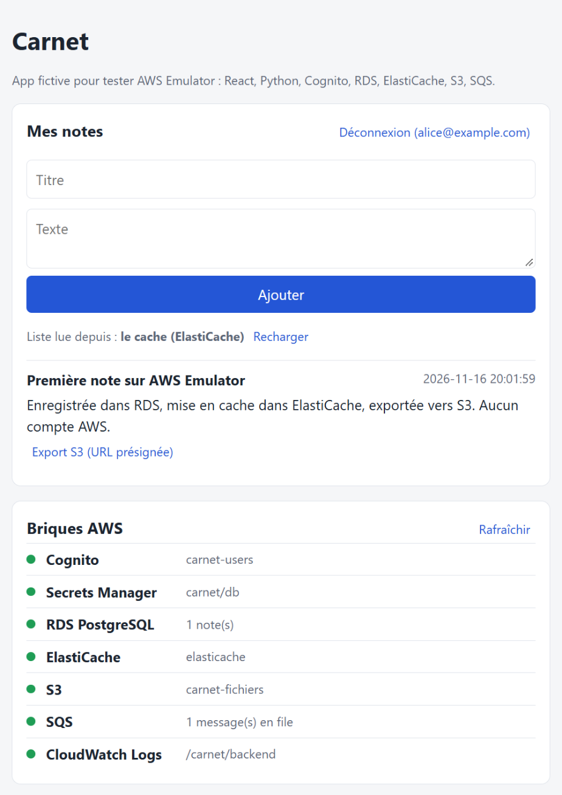

# Carnet: a small app to test AWS Emulator

A fictional note-taking app ("carnet" is French for notebook) that uses the AWS building blocks a development team touches every day. It exists to measure what [AWS Emulator](https://github.com/aws/aws-emulator) can do locally, with no AWS account.

> **This is a snapshot, published as is and not maintained.** The results below are from November 16, 2026, on emulator 1.0.471. The emulator ships several releases a day, so expect different numbers when you run it. That is the point: run it again and compare.

> Version française : [README.fr.md](README.fr.md)



| Part | Stack | AWS services |
| --- | --- | --- |
| Front end | React (Vite) | none, it only calls `/api` |
| Back end | Python (FastAPI, boto3) | Cognito, Secrets Manager, RDS PostgreSQL, ElastiCache, S3, SQS, CloudWatch Logs |
| Infrastructure | Shell script and AWS CLI, then Terraform | the same, plus VPC, security groups, ALB, ACM, CloudWatch, SES |

## Results on November 16, 2026

**AWS CLI script: 66 of 72 checks pass, 6 fail, no 501 errors.**

- The control plane of all thirteen services answers without a 501 in this scope.
- **Cognito** issues real RS256 tokens, verifiable through JWKS. The issuer is the emulator's address, not `cognito-idp.<region>.amazonaws.com`.
- **RDS** exposes a local port that speaks the PostgreSQL protocol, but it is not a real PostgreSQL: `now()`, `serial`, `identity` and `gen_random_uuid()` fail. The back end sticks to portable SQL.
- **ElastiCache** exposes a local port that speaks Redis (PING, SET, GET, INCR), but not `HSET` or `LPUSH`, and only over RESP2: with redis-py 8 you need `protocol=2`.
- **ALB**: a public ALB requires an internet gateway on the VPC, as on AWS. No traffic flows through the emulated ALB.
- **ACM, SES**: states move on their own (certificate goes to `FAILED` after about 3 s, SES identity is verified after about 0.5 s). No email is delivered.

**Terraform: 25 of 31 resources created, empty control plan, complete destroy.** Three blockers:

| Blocker | What happens | Workaround |
| --- | --- | --- |
| AWS provider 6.x and S3 | Creating a bucket hangs: the provider reads tags through the S3 Control API, whose requests do not reach the emulator | Stay on provider 5.x (tested with 5.100.0) |
| Security groups | Terraform revokes the default egress rule at creation; the emulator answers `InvalidPermission.NotFound`, even though it lists the rule | None found |
| RDS without a version | Without `engine_version`, creation is rejected ("Cannot find version for postgres") | Set `engine_version` |

Full reports from that run: [rapport-exemple.md](rapport-exemple.md) (CLI) and [rapport-terraform-exemple.md](rapport-terraform-exemple.md) (Terraform). They are in French, like the script output.

## Run it with Docker

The only prerequisite is Docker. Nothing is installed on your machine.

```bash
docker compose up --build
```

This starts the emulator, runs the `test` service (which creates the infrastructure with the AWS CLI and writes `rapport.md`), then starts the back end and the front end.

- Front end: http://localhost:5173
- API: http://127.0.0.1:8000/docs
- Test account: `alice@example.com` / `Demo-Pass-123!`
- Start from scratch: `docker compose down -v && docker compose up`
- Pick up a newer emulator release: `docker compose build --no-cache`

The same infrastructure with Terraform, once the stack is up (about 4 minutes):

```bash
docker compose --profile terraform run --rm terraform
```

It writes `rapport-terraform.md`.

### Why every container shares one network

All services use `network_mode: service:emulateur`, so they talk to each other on 127.0.0.1, as on a developer laptop. This is required: the emulator announces the RDS endpoint on `127.0.0.1:<random port>`, and its TLS certificate is only valid for 127.0.0.1.

## Run it without Docker

On Debian, Ubuntu or WSL:

```bash
curl -fsSLo aws-emulator.deb https://downloads.aws.com/aws-emulator/packages/aws-emulator/LTS/latest/aws-emulator_amd64.deb
sudo apt-get install -y ./aws-emulator.deb
```

You also need AWS CLI v2, `psql` for the SQL probes, Python 3.10+, Node 18+ and, for the Terraform test, Terraform 1.6 or later.

```bash
aws-emulator -t off                          # terminal 1: the emulator, telemetry off
./scripts/test-emulateur.sh                  # terminal 2: writes rapport.md and backend/.env
./scripts/lancer-backend.sh                  # terminal 2: API on http://127.0.0.1:8000
cd frontend && npm install && npm run dev    # terminal 3: http://localhost:5173
./scripts/test-terraform.sh                  # optional: the Terraform test
```

The emulator keeps its state in memory. After a restart, run `test-emulateur.sh` again: the database port changes on every creation.

## What is in the repository

| Path | What it is |
| --- | --- |
| `scripts/test-emulateur.sh` | Creates the infrastructure with the AWS CLI, plays a scenario, classifies each step (OK, failed, 501) |
| `scripts/test-terraform.sh` | Runs apply, a control plan and destroy, and reports per resource |
| `terraform/main.tf` | The same infrastructure, 31 resources |
| `backend/main.py` | FastAPI back end, plain boto3 with no emulator-specific code |
| `frontend/` | React front end with a status panel for each AWS service |
| `docker-compose.yml`, `docker/` | The emulator, the tests and the app in containers |

## Good to know

- **Script labels and comments are in French.** The scripts are published exactly as they were run.
- **The credentials in the code are test values.** `Demo-Pass-123!` and `Carnet-Demo-2026` only exist inside the emulator. No real AWS account or secret is involved.
- **AWS CLI v1 trap.** CLI v1 ignores `AWS_ENDPOINT_URL` for RDS in us-east-1 and sends the call to real AWS. The script passes `--endpoint-url` on every call for that reason.
- **Written with AI assistance.** The code and scripts were written with the help of Claude (Anthropic). I chose the scope, ran the tests on my machine and reviewed the results.
- **Not affiliated with AWS.** This is a personal test and a personal opinion.

## License

[MIT](LICENSE)
